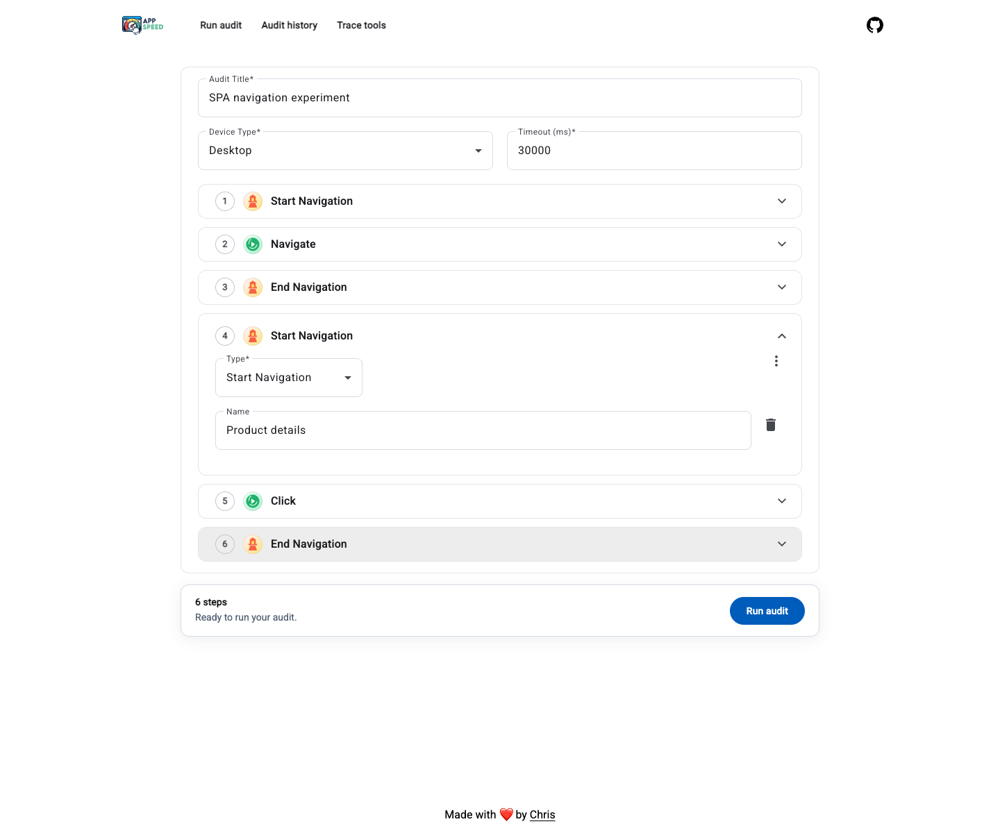
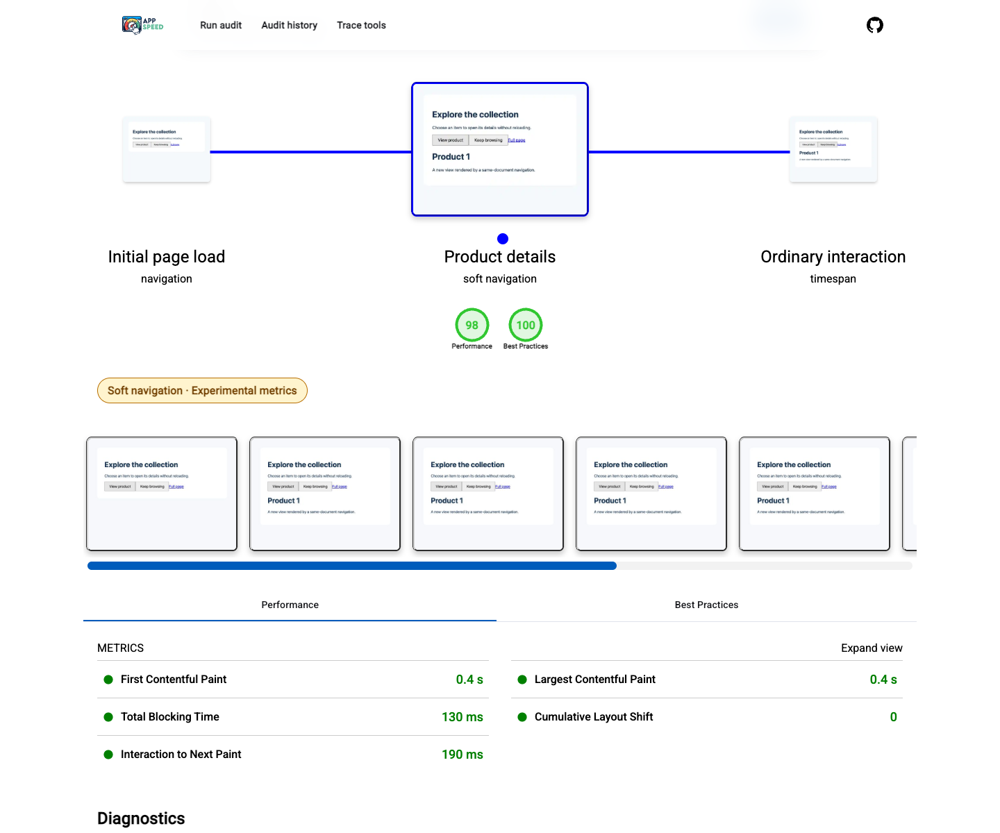
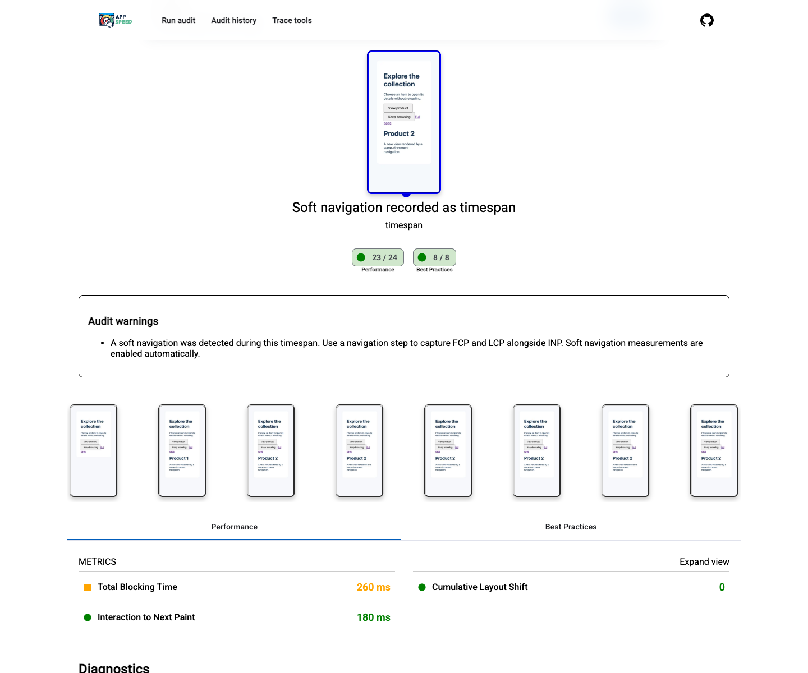

# Soft navigation experiment

The experiment is enabled by default, using stock Lighthouse 13.6.0 and local Performance audit overrides.
There is no dependency patch or builder toggle.

Use **Start Navigation**, the interaction steps, then **End Navigation**. A navigation containing an explicit
**Navigate** action uses Lighthouse's native page-load runner. Interaction-driven navigation steps collect
an interaction trace and use the local FCP/LCP audits. If a click falls back to a document load, the soft
paint metrics report missing detection instead of presenting document paints as soft-navigation results.
Use a snapshot afterwards to audit the resulting page state.

```json
[
  { "type": "customStep", "step": "startNavigation", "name": "Initial page load" },
  { "type": "navigate", "url": "https://example.com" },
  { "type": "customStep", "step": "endNavigation" },
  { "type": "customStep", "step": "startNavigation", "name": "Product details" },
  { "type": "click", "offsetX": 40, "offsetY": 15, "selectors": [{ "segments": ["#product"] }] },
  { "type": "customStep", "step": "endNavigation" }
]
```

The application result remains `gatherMode: "navigation"` and has `softNavigation: true` on its flow step.
Standard FCP, LCP, and INP appear in Performance. The viewer displays an amber
**Soft navigation · Experimental metrics** badge. Exported Lighthouse HTML uses its existing Navigation label.

## Local implementation

`libs/audit/user-flow/runner/src/lib/soft-navigation/` contains the flow adapter, configuration overrides,
and trace timing extraction. The implementation is informed by
[GoogleChrome/lighthouse#17075](https://github.com/GoogleChrome/lighthouse/pull/17075) and the earlier
[soft-navigation plugin](https://github.com/adamraine/lighthouse-plugin-soft-navigation).
Lighthouse itself is unmodified. The version is pinned because the experiment reads Chrome trace formats
and imports Lighthouse's native metric classes and processed-trace helper.

For an interaction-driven navigation, Lighthouse's public timespan API collects the trace without resetting
page state. The local FCP/LCP audits use the first main-frame `SoftNavigationStart`, its first-contentful-paint
timestamp, and LCP candidates with the matching navigation ID. The adapter records the result as an
application navigation step. Native INP measures the interactions recorded in that step and keeps its zero
Performance-score weight. Explicit page-load navigation steps delegate paint metrics to the native audits.

The adapter waits for navigation and then starts a fresh network-quiet window. An idle period before a
recorded click cannot satisfy the post-navigation wait. Quiet time is bounded by the audit timeout; very
late rendering without network activity can still outlast the observation window.

This requires Chrome 149 or newer. FCP/LCP use experimental page-load scoring curves. INP is scripted lab
responsiveness for the complete step, not a whole-visit real-user INP value. With no user interaction,
INP is not applicable. Multiple soft navigations produce a warning: FCP/LCP describe the first, while INP
covers interactions in the recorded step.

If a timespan contains a confirmed main-frame soft navigation, its report warns once:

> A soft navigation was detected during this timespan. Use a navigation step to capture FCP and LCP
> alongside INP. Soft navigation measurements are enabled automatically.

A URL/content update without a detected soft navigation does not trigger this warning. Timespans retain
their native interaction metrics and are not converted automatically. Missing detections and metric
errors appear in the viewer and exported HTML.

## Verification

```shell
pnpm exec nx run audit-user-flow-runner:integration
```

This uncached target runs Puppeteer's Chrome against a local fixture. It checks native page loads,
automatic soft navigation metrics, timespan recommendations, missing detection, programmatic URL updates,
and multiple detections. The triggering click blocks for 180 ms; its INP is compared with Chrome's Event
Timing observer and a trace event with the same interaction ID and exact duration. Regression tests cover
an idle delay before a click that fetches delayed content and a click that falls back to a full page load.

Set `APP_SPEED_SOFT_NAV_ARTIFACTS` to an absolute directory to retain real flow result JSON, exported HTML,
and `triggering-interaction.json`. Screenshots use this captured data through fixture API responses;
database persistence is not exercised in the screenshot session.






