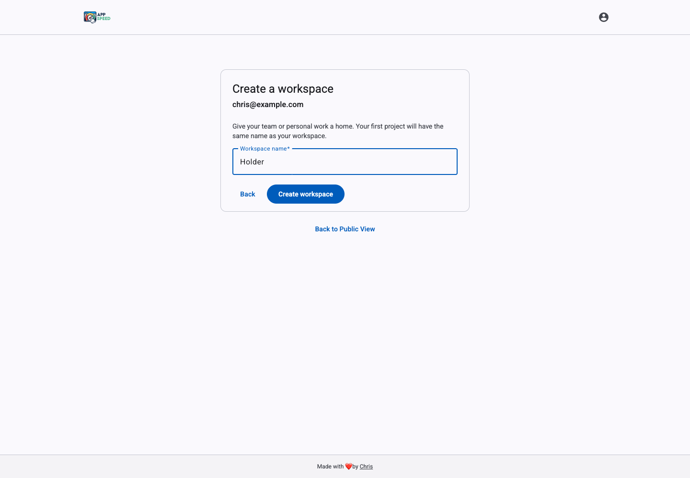
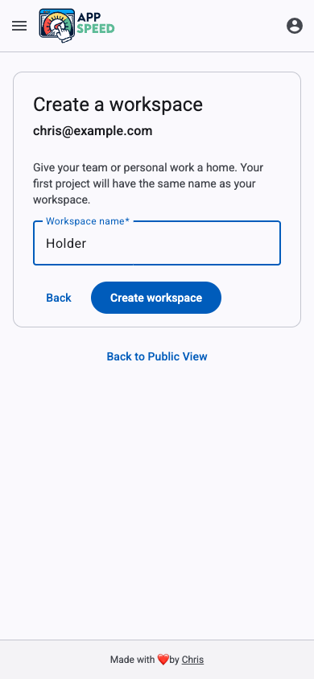
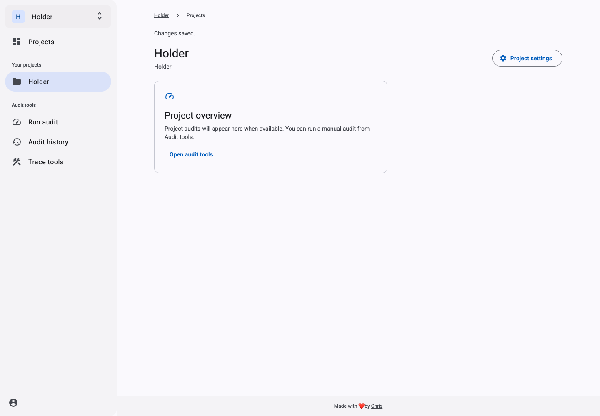

# Initial auth setup

Current portal screens captured at desktop (1440 × 1000) and mobile (390 × 844) sizes.
These captures use sample account data and intercepted workspace API responses. They show the real UI,
but do not verify live Clerk sign-in or database persistence. Database behavior is covered separately by
the workspace management tests against PGlite.

Creating a workspace creates its same-named first project and opens it directly. Public View exposes
the anonymous public tools outside workspace/project scope.

## Create a workspace

## Open the default project

